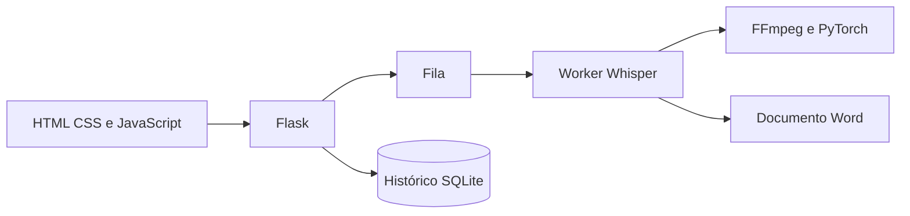

# VoxTexto

## 1. Apresentação

Aplicação web local para transcrever áudio e vídeo com Whisper e gerar documentos Word.

## 2. Problema empresarial

Transformar gravações em texto revisável, acompanhando fila, falhas e resultados.

## 3. Objetivo

Organizar o processamento local e a exportação das transcrições, mantendo o servidor responsivo.

## 4. Funcionalidades implementadas

- Seleção de mídias e fila de processamento.
- Whisper em processo separado, com cancelamento e tratamento de falhas.
- Histórico por usuário e exportação para Word.
- Interface HTML/CSS/JavaScript e distribuição Windows existente.

As funcionalidades foram identificadas nos módulos e na documentação originais. Os resultados de verificação desta cópia estão em [Validação](docs/github/VALIDACAO.md); não se alegam ganhos de negócio ou métricas de produção.

## 5. Tecnologias

Python 3.13, Flask, Whisper, PyTorch, FFmpeg, python-docx e SQLite. A aplicação fonte não utiliza React ou backend remoto.

Os manifests originais foram preservados. Nenhuma dependência nova foi adicionada à aplicação para esta apresentação.

## 6. Arquitetura



[Arquitetura e limites da cópia](docs/github/ARQUITETURA.md).

## 7. Estrutura de pastas

```text
app.py                         aplicação e processamento
templates/                     páginas HTML
static/                        estilos, scripts e recursos
scripts/validate_release.py    consistência da versão
tests/test_release.py          testes de versão
requirements.txt               ambiente fonte
requirements-windows-exe.txt   ambiente de build Windows
.github/workflows/             pipeline Windows existente
```

Ambientes instalados, caches, bancos operacionais, configurações privadas e compilados ficam fora do pacote fonte. [Critérios de seleção](docs/github/SEGURANCA.md).

## 8. Instalação

Requisitos: Python 3.13 e FFmpeg instalado e disponível no PATH. Na raiz:

```powershell
py -3.13 -m venv .venv
.\.venv\Scripts\python.exe -m pip install -r requirements.txt
ffmpeg -version
```

O primeiro uso pode precisar baixar os pesos do modelo Whisper. O ambiente de build Windows usa requisitos separados; não confundir suas versões com o ambiente fonte.

## 9. Configuração do ambiente

Não há .env.example necessário para executar o fluxo fonte documentado. Esta cópia não contém sessao.key, historico.db, uploads ou documentos do autor. A aplicação gera seu estado local durante o uso; .gitignore impede o versionamento desses arquivos. Não reutilize a chave de sessão de outra instalação.

## 10. Como executar

```powershell
.\.venv\Scripts\python.exe app.py
```

Acesse http://localhost:5000. Consulte a página do projeto para a distribuição Windows pronta. O processamento ocorre localmente; a qualidade e o tempo dependem do áudio, modelo e recursos disponíveis.

Os comandos desta documentação se destinam a uma cópia preparada pelo leitor; não foram usados para iniciar a operação do autor nesta etapa.

## 11. Como testar

Os testes de versão usam apenas a biblioteca padrão:

```powershell
python -m unittest discover -s tests -v
python scripts/validate_release.py
```

Eles conferem aplicação, metadados e nome do instalador. Não são testes de acurácia nem uma execução real de transcrição. Nenhum áudio do autor acompanha a cópia.

[Resultados e limitações da verificação desta preparação](docs/github/VALIDACAO.md).

## 12. Capturas e demonstrações reais

[Veja as telas e demonstrações já existentes no portfólio](https://leandroaugferreira.github.io/python.html). Não foram criadas imagens fictícias nem alteradas as mídias do projeto.

## 13. Limitações conhecidas

Código identificado como V2.0. O cabeçalho histórico de requirements.txt ainda menciona uma versão anterior. Fonte e build Windows têm versões de PyTorch distintas declaradas nos respectivos manifests. Não foi repetida uma transcrição real nem produzido um instalador nesta preparação.

## 14. Estado atual

Código-fonte disponibilizado pelo autor para demonstração e avaliação técnica. As evidências locais de 02/11/2026 estão em docs/github/VALIDACAO.md. Os limites e gates de produção descritos na documentação continuam aplicáveis.

A licença MIT original foi preservada em [LICENSE](LICENSE).

[Notas da versão](docs/releases/V2.0.md)

## 15. Portfólio

[VoxTexto no portfólio](https://leandroaugferreira.github.io/python.html) · [Portfólio completo](https://leandroaugferreira.github.io/).

Repositório: [LeandroAugFerreira/transcricao-audio-web](https://github.com/LeandroAugFerreira/transcricao-audio-web).
