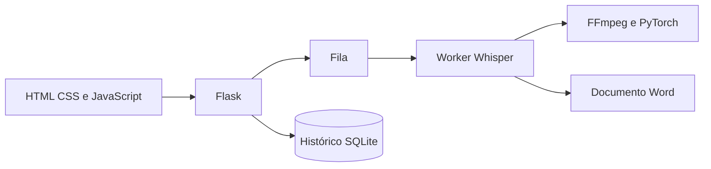

# Arquitetura observada

Python 3.13, Flask, Whisper, PyTorch, FFmpeg, python-docx e SQLite. A aplicação fonte não utiliza React ou backend remoto.

Código identificado como V2.0. O cabeçalho histórico de requirements.txt ainda menciona uma versão anterior. Fonte e build Windows têm versões de PyTorch distintas declaradas nos respectivos manifests. Não foi repetida uma transcrição real nem produzido um instalador nesta preparação.

O diagrama resume relações encontradas no código; não representa uma implantação em produção. Serviços externos opcionais não foram ativados nesta preparação.
